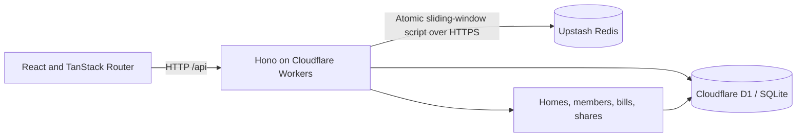
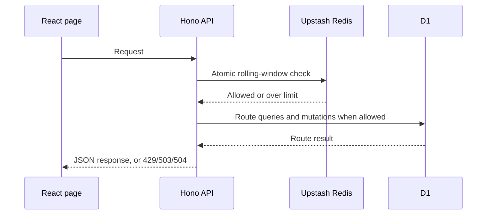

# SDE Intern Assignment: Shared Bill Splitter

Welcome. In this assignment you build a small bill splitter for a shared home. It has two parts:

1. **Homes and members:** create a home and add members to it.
2. **Bill splitting:** split a bill between the members. Each member pays their own share.

The assignment is small on purpose. We want correct, safe, and clear code. We do not want many features.

## What we look at

- **Your code passes the tests.** The tests decide, not opinion. You get the visible tests. We also run extra tests that you do not see.
- **Your code is safe when things go wrong.** Wrong input, repeated requests, and two requests at the same time must not break your data.
- **Your code is typed.** Use TypeScript. Do not use `any`.
- **You understand your code.** You record a short video and explain it.

Take your time. A careful, correct solution is better than a fast one. We expect 2 to 3 days of real work.

## Stack (required)

- **API:** Hono on Cloudflare Workers
- **Database:** Cloudflare D1 (SQLite). The binding is `DB` in `api/wrangler.jsonc`.
- **Web:** React, Vite, TanStack Router
- **Language:** TypeScript on both sides
- **Tests:** Vitest, running inside the Workers runtime
- **Quality:** Biome. `pnpm check` and `pnpm typecheck` must pass.

You choose the rest (styling, form library, validation library). Pick tools you can explain.

## The task

The assignment has two parts. Do Part 1 first. Part 2 builds on it.

**Database.** Write the schema as SQL migration files in `api/migrations/`. For example `0001_init.sql`. The tests apply every file in this folder. Your schema must have **at least 3 named constraints** that protect the data. For example a foreign key, a `CHECK`, or a `UNIQUE` key. Be ready to explain what each constraint stops.

**Errors.** Every error response is JSON: `{ "error": "message" }`.

## Part 1: Homes and members

Create a home and add members to it. The order in which members are added matters in Part 2.

#### `POST /api/homes`

- Request: `{ "name": string }`
- Success: `201` `{ id, name }`

#### `POST /api/homes/:homeId/members`

- Request: `{ "name": string }`
- Success: `201` `{ id, homeId, name }`
- Errors: `404` home not found

Visible tests: `api/test/homes.test.ts`.

## Part 2: Bill splitting

Add a bill to a home, split it between the members, and let each member pay their share.

All amounts are whole **cents** (integers). `100` cents is 1 dollar. Never use decimals for money.

#### `POST /api/homes/:homeId/bills`

- Request: `{ "title": string, "totalCents": number }`
- Success: `201` `{ id, homeId, title, totalCents, shares: [{ id, memberId, amountCents, paidAt: null }] }`
- Errors: `404` home not found. `422` total is not a positive whole number, or the home has no members.

#### `POST /api/bills/:billId/shares/:shareId/pay`

- Request: header `Idempotency-Key`
- Success: `200` `{ id, memberId, amountCents, paidAt }`
- Errors: `400` key missing. `404` bill or share not found. `409` share already paid with a different key.

#### `GET /api/homes/:homeId/balances`

- Success: `200` `{ balances: [{ memberId, name, outstandingCents }] }`
- Errors: `404` home not found

**Rules**

- **Split.** A bill is split between all members of the home. The shares always add up to `totalCents`. If the amount does not divide evenly, the extra cents go to the members one by one, in the order the members were added to the home. Example: 1000 cents between 3 members gives `334`, `333`, `333`.
- **Pay.** Paying marks one share as paid and sets `paidAt`. If the same `Idempotency-Key` is sent again for the same share, answer `200` with the same result. Do not pay twice. If two requests pay the same share at the same time, only one may succeed.
- **Balances.** `outstandingCents` is the sum of the member's unpaid shares, across all bills of the home. List the members in the order they were added.

Visible tests: `api/test/bills.test.ts` and `api/test/payments.test.ts`.

#### Web page

Build one page that:

- shows the bills of a home and the shares of each bill,
- lets a member pay a share,
- shows clear **loading**, **empty**, and **error** states,
- keeps the share unpaid and shows an error if the payment fails.

The page must not crash when the API answers with an error or is slow.

## Cases you must handle

You must handle these cases and talk about them in your video:

1. A home with no members.
2. An amount that is zero, negative, or not a whole number.
3. An amount that does not divide evenly.
4. The same payment request sent twice.
5. Two members paying the same share at the same time.
6. A bill or share that does not exist.
7. The API answers with a 500 error or is slow. The web page must not crash.

## Run it

This is a pnpm workspace. Install once at the root.

```bash
pnpm install
pnpm dev          # api on :8787 and web on :5173
```

Open http://localhost:5173. The starter page shows a title. `/api/health` returns `{ "status": "ok" }`.

```bash
pnpm test         # run the visible tests in api/test
pnpm check        # Biome: format and lint. Must pass.
pnpm check:fix    # fix what Biome can fix
pnpm typecheck    # tsc on both packages. Must pass.
pnpm build        # production build of the web app
```

`pnpm dev` applies your migrations to a local database before it starts the API.

If pnpm says some build scripts were ignored, run `pnpm approve-builds` and allow `esbuild` and `workerd`.

When you change `api/wrangler.jsonc`, refresh the `Env` types:

```bash
pnpm --filter bill-splitter-api cf-typegen
```

## Rules for the tests

- The visible tests are in `api/test`. They start with a failing result. Your job is to make them pass.
- Do **not** change the visible tests or `api/test/helpers.ts`. We compare them with the original.
- We run extra tests after you submit. They test the cases in "Cases you must handle" more closely.

## AI policy

You can use AI tools. Tell us which ones and where in your answers on the form.
You must understand every line you submit. We check this with your video and in a live call. "The AI wrote it" is not an answer.

## How to submit

1. Click **Use this template**, then **Create a new repository**. Make the repository **public**.
2. Build your solution in your new repository. Small, clear commits are welcome.
3. Update this README with a short section called **Decisions**. Write 3 decisions you made and why.
4. Record a video of **3 minutes or less** (Loom or unlisted YouTube). Show the architecture, the data flow, and one trade-off you made. Make sure anyone with the link can view it.
5. Paste the repository link and the video link in the application form.

## Implemented design

### HLD

The React page calls the Hono API through Vite's `/api` proxy in development. The API runs on Cloudflare Workers and persists homes, members, bills, shares, and payment state in D1. An Upstash Redis REST endpoint enforces a shared per-IP sliding window across API routes. The browser keeps only the selected home ID; bill and payment data remain in D1.



### LLD

- `homes` own members and bills. `members.sequence` preserves member creation order for split remainders and balances.
- A bill stores its total in integer cents. Its shares are created in one D1 batch; each receives the base amount, and the first members in creation order receive any remaining cents.
- A share stores its amount, optional payment timestamp, and idempotency key. Payment uses a conditional `UPDATE ... WHERE paid_at IS NULL`, then reads the row to resolve retries and competing requests.
- Balances sum unpaid share amounts per member. The web page loads bills and balances together to show share names, and reloads the home after a successful payment.
- Middleware applies a 10-second deadline to API handling and checks the caller IP against Redis before dispatching the route. Redis commands have a 2-second client-side timeout; missing configuration, Redis errors, and invalid Redis responses fail closed with `503`.
- The sliding window records request timestamps in a Redis sorted set. One atomic Lua `EVAL` removes entries older than 60 seconds, rejects once 100 remain, and adds accepted requests. Members use unique sorted-set values so concurrent calls at the same millisecond are counted separately.



### Redis and timeout configuration

Set `REDIS_REST_URL` and `REDIS_REST_TOKEN` as Cloudflare Worker secrets/bindings. The URL and token must point to an Upstash Redis database with REST access enabled. API calls are limited to 100 per caller IP in any rolling 60-second interval. Exceeding the limit returns JSON `429` and `Retry-After`; missing IP metadata or unavailable Redis returns JSON `503`. The API deadline is 10 seconds and returns JSON `504`. The response deadline does not cancel D1 work that has already started.

Local `pnpm dev` runs Wrangler's `local` environment, which sets `RATE_LIMIT_DISABLED=true` so the app works without external Redis credentials. Vitest uses the same explicit bypass. The default/deployed Worker environment does not set this binding and remains fail-closed if Redis is not configured; do not add the bypass to production.

### Routes

| Method and path                               | Behavior                                             | Responses                                                                                  |
| --------------------------------------------- | ---------------------------------------------------- | ------------------------------------------------------------------------------------------ |
| `GET /api/health`                             | Health check                                         | `200 { status }`                                                                           |
| `POST /api/homes`                             | Create a home from `{ name }`                        | `201 { id, name }`; `422` invalid name                                                     |
| `POST /api/homes/:homeId/members`             | Add `{ name }` to a home                             | `201 { id, homeId, name }`; `404` missing home; `422` invalid name                         |
| `POST /api/homes/:homeId/bills`               | Create `{ title, totalCents }` and split into shares | `201` bill with shares; `404` missing home; `422` invalid amount or no members             |
| `GET /api/homes/:homeId/bills`                | List bills and shares for the web page               | `200 { bills }`; `404` missing home                                                        |
| `POST /api/bills/:billId/shares/:shareId/pay` | Pay a share with `Idempotency-Key`                   | `200` paid share; `400` missing key; `404` missing bill/share; `409` paid with another key |
| `GET /api/homes/:homeId/balances`             | List outstanding member totals in member order       | `200 { balances }`; `404` missing home                                                     |

Errors use JSON `{ "error": "message" }`. Unexpected API exceptions return a generic JSON `500` response.

### Edge-Case & Robustness Self-Audit

1. **API request fails, returns a 500, or has an unexpected/non-JSON error body:** the page catches rejected `fetch` calls and JSON parsing failures. It shows the API's `error` message when available, otherwise a generic request/payment message; the rejected promise does not escape the event handler or effect. The API's Hono error handler returns a JSON `500` for uncaught server errors.
2. **Two clients pay the same share concurrently, or the client retries after a successful payment:** the conditional D1 update lets only one request move the row from unpaid to paid. A subsequent request with the same key returns the saved payment result; a different key gets `409`. The page only reloads its displayed share state after a successful response, so a failed payment leaves the share displayed as unpaid and shows an error.
3. **Redis is unavailable or slow:** Redis requests are aborted after 2 seconds; the limiter fails closed with a JSON `503`, so routes do not run without enforcing the configured limit. The API-wide 10-second deadline returns JSON `504` if route handling takes too long. This deadline does not cancel D1 operations already in progress.
4. **A client exceeds the request allowance:** the Redis Lua script atomically expires old timestamps and checks/adds the current request, preventing parallel requests from bypassing the 100-per-60-second threshold. The API returns JSON `429` with a retry delay.

## Decisions

1. Store money as integer cents so bill splitting never depends on floating-point rounding.
2. Use a conditional database update and an idempotency key for payments so retries do not pay a share twice.
3. Keep the web page focused on one home at a time and load bills and member balances from the API, keeping payment state on the server.

We will run `pnpm install && pnpm check && pnpm typecheck && pnpm test` on your repository.
